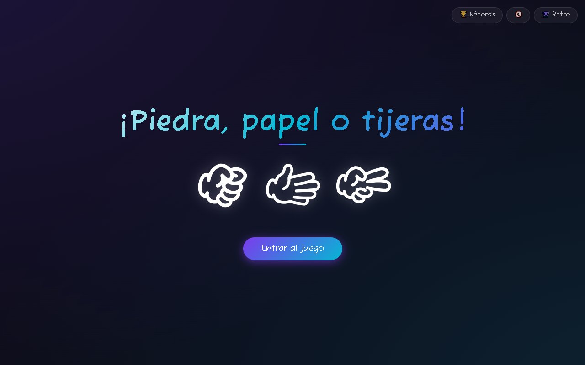
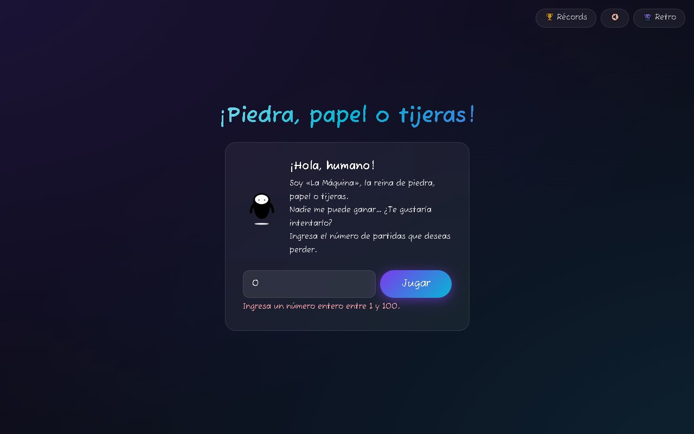
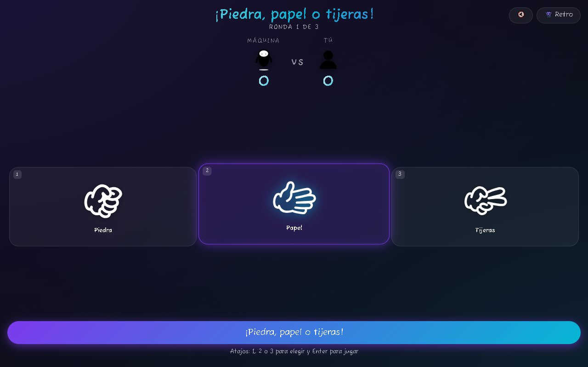
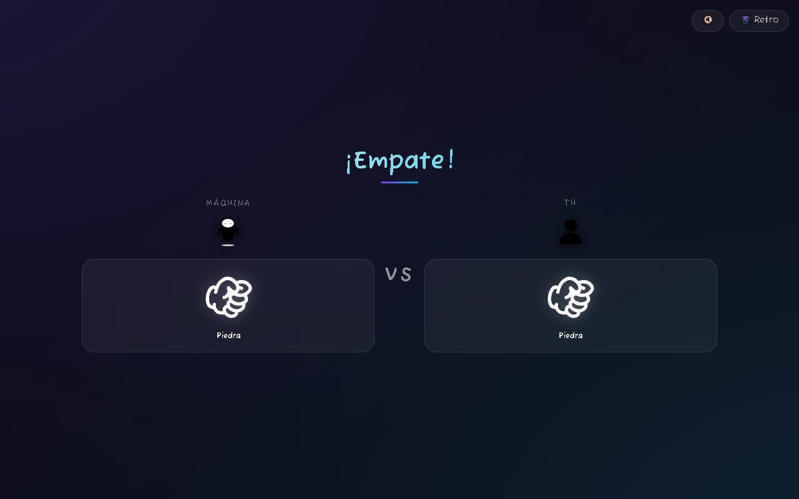
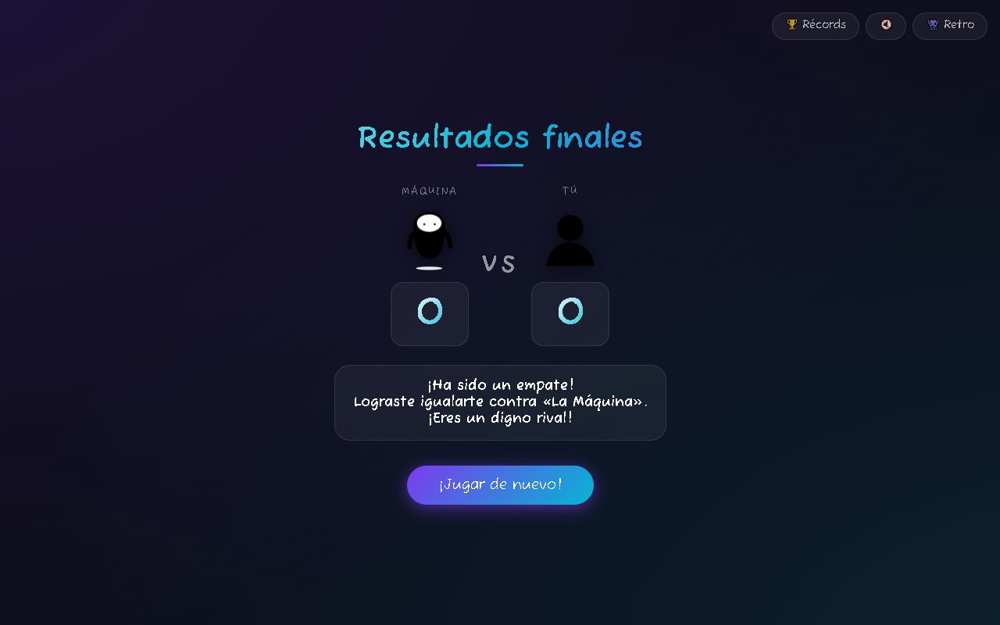
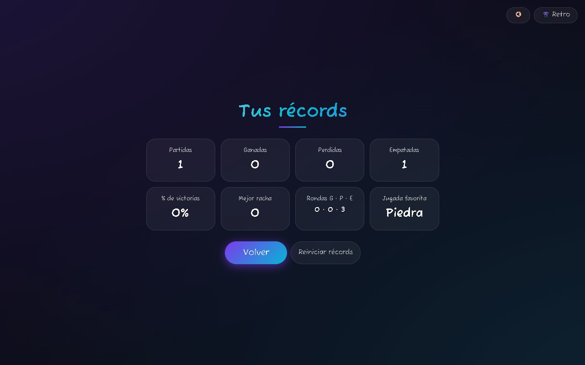
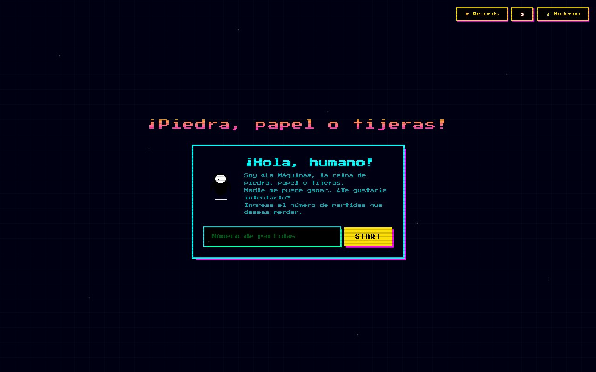
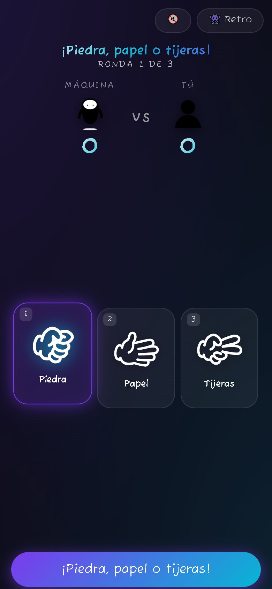

# ¡Piedra, papel o tijeras!

Juego de piedra, papel o tijeras contra «La Máquina», hecho con **Angular 22** (zoneless + Signals) y disponible como **aplicación web** y como **app para Android**. Eliges cuántas partidas jugar, cambias entre un tema moderno y uno retro de 16 bits, y el juego guarda tus récords.

**Aplicación en línea:** https://purple-plant-0c461dd0f.8.azurestaticapps.net
**Android:** [descargar la APK](https://github.com/Sheshinmcfly/piedraPapelTijeras/releases/latest)



## Funcionalidades

- **Partidas a medida:** de 1 a 100 rondas, con marcador en vivo y resultado de cada ronda.
- **Dos temas:** moderno (glassmorphism, gradientes violeta y cian) y **retro de 16 bits** (fuente pixelada, scanlines y colores neón). El tema elegido se recuerda.
- **Récords:** partidas ganadas, perdidas y empatadas, porcentaje de victorias, mejor racha, rondas y jugada favorita, guardados en el navegador.
- **Música de fondo** con botón para silenciarla; la preferencia se recuerda.
- **Accesible:** se juega completo con teclado (Tab, Enter y los atajos **1**, **2** y **3**) y los resultados se anuncian a lectores de pantalla. Las 14 pantallas (7 por tema) pasan la auditoría de accesibilidad de axe-core sin violaciones.
- **App Android** generada con Capacitor a partir del mismo código, con ícono y pantalla de carga propios.

## Capturas

| Elegir partidas | Jugada |
|---|---|
|  |  |
| **Resultado de la ronda** | **Resultado final** |
|  |  |
| **Récords** | **Tema retro de 16 bits** |
|  |  |

<p align="center"></p>

## Stack

- **Angular 22**: componentes standalone, aplicación *zoneless*, Signals (`signal`, `computed`, `effect`), control flow y animaciones nativas (`animate.enter` / `animate.leave`).
- **TypeScript 6** y **Bootstrap 5.3**.
- **Capacitor 8** para la app Android.
- **Vitest** para los tests unitarios (41 tests).

## Decisiones técnicas

**Modernización de Angular 17 a 22.** Se actualizó versión por versión con las migraciones oficiales, se quitó zone.js y los tests pasaron de Karma/Jasmine a Vitest. Las transiciones entre pantallas dejaron `@angular/animations` (obsoleto desde Angular 20.2) y usan las animaciones nativas con CSS. Las fuentes se incluyen en la app en lugar de cargarse desde Google Fonts. La carga inicial bajó de 127 KB a 82 KB transferidos.

**Estado con Signals.** Cada pantalla deriva su vista de signals; las estadísticas viven en un servicio propio que persiste en el navegador y tolera datos corruptos.

**Accesibilidad.** Las opciones son botones con `aria-pressed`, hay atajos de teclado, una región `aria-live` anuncia cada resultado, el campo de partidas valida con mensaje de error asociado y las animaciones respetan `prefers-reduced-motion`.

## Cómo ejecutarlo

Requiere Node.js 22.22.3+, 24.15+ o 26+ (mínimo exigido por Angular CLI 22).

```bash
npm install
npm start          # servidor de desarrollo en http://localhost:4200
npm test           # tests unitarios (Vitest)
npm run build      # build de producción en dist/piedra-papel-tijeras/browser
```

### App Android

Requiere Android Studio (SDK de Android y JDK 21).

```bash
npm run build
npx cap sync android
cd android
./gradlew assembleDebug
```

La APK queda en `android/app/build/outputs/apk/debug/app-debug.apk`. Los íconos y la pantalla de carga se generan desde `resources/` con `npx @capacitor/assets generate --android`.

## Despliegue

La versión web está publicada en **Azure Static Web Apps** (plan Free). Cada push ejecuta el pipeline de Azure DevOps definido en `azure-pipelines.yml`: instala dependencias, corre los tests y hace el build; si el push es a `main` y todo pasa, despliega la nueva versión automáticamente. Los headers de seguridad (CSP incluida) y la caché se configuran en `public/staticwebapp.config.json`.

La APK de Android se publica en [GitHub Releases](https://github.com/Sheshinmcfly/piedraPapelTijeras/releases).

## Historia

La primera versión (2021) era un juego en JavaScript sin framework. En 2026 se reescribió en Angular 17 con tema retro y app Android, y luego se modernizó a Angular 22 con accesibilidad completa, récords, música silenciable y despliegue continuo en Azure.
